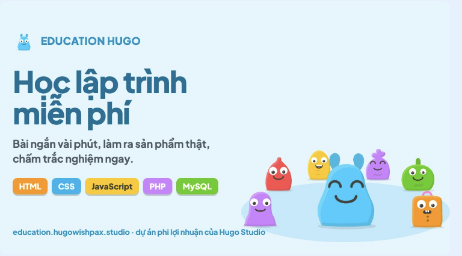
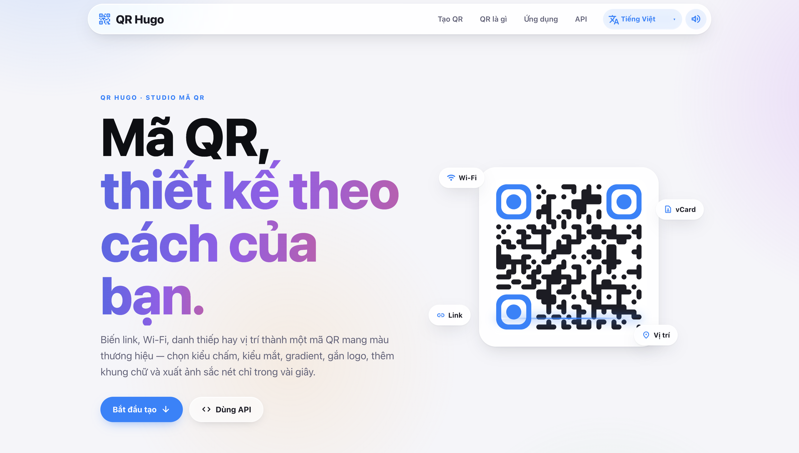

<!-- AVATAR MASCOT & LOGO HEADER -->

# Hugo Studio

`Independent Digital Design & Software Studio · Saigon`

Design with purpose. Code with passion. From concepts to scalable digital ecosystems.

 

<!-- 3D PORTAL BUTTON -->

---

### 🧰 Languages and Tools

   &nbsp;
   &nbsp;
   &nbsp;
   &nbsp;
   &nbsp;
   &nbsp;
   &nbsp;
  

---

### 🚀 Community Ecosystem & Live Apps

<table border="0">
  <tr>
    <td width="50%" valign="top">
      
        
      <b>🎓 Hugo Edu+</b>
      
An open-access platform built to learn programming through hands-on exercises, creative interface interactions, and engaging web mechanics.

      <a href="https://education.hugowishpax.studio" target="_blank">education.hugowishpax.studio ↗</a>
    </td>
    <td width="50%" valign="top">
      
        
      <b>📱 Hugo QR</b>
      
A fast visual generator for custom QR codes with real-time design tuning and integrated REST APIs for seamless application embedding.

      <a href="https://qr.hugowishpax.studio" target="_blank">qr.hugowishpax.studio ↗</a>
    </td>
  </tr>
</table>

---

  📩 <b>Contact & Collaboration:</b> <a href="mailto:hugostudiodev@gmail.com">hugostudiodev@gmail.com</a> • <a href="https://www.hugowishpax.studio">hugowishpax.studio</a>

